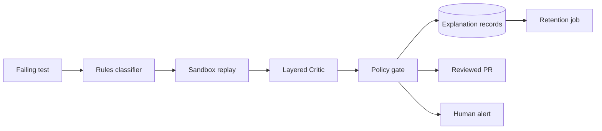

# Compliance support (tooling output; **legal review required**)

> This document and its generators produce *evidence*, not legal advice.
> A qualified human owner must review data handling, licenses, and vendor
> terms before any production use.

## Data-flow diagram (placeholder)

## Data classification

| Data | Class | Handling |
|---|---|---|
| Explanation records, audit log | Internal | Append-only, masked PII, retained per schedule |
| DOM snapshots, screenshots metadata | Confidential | PII-masked before storage or external calls |
| Credentials, private keys | Secret | Env vars only, never code/logs; rotated per policy |
| Benchmark fixtures | Public | Versioned in repo |

## Retention and deletion schedule

| Artifact | Retention | Enforced by |
|---|---|---|
| `records.jsonl`, `audit.log` | 365 days | `healing/security/retention.py` (dry-run default; `--apply` deletes) |
| `alerts.log` | 180 days | same job |
| `screenshots/` | 90 days | same job |

Run: `python -m scripts.retention` (dry-run) or `--apply` to delete.

## License scan and SBOM

- `python -m scripts.sbom` writes `sbom.json` (name, version, license per
  installed distribution, stdlib only).
- `python -m scripts.sbom --check` fails closed on an unknown license or a
  license outside the allowlist. The CI `compliance` job, `make sbom`, and
  `python tasks.py sbom` run the check.
- Allowlist: `MIT, MIT-0, MIT-CMU, Apache-2.0, BSD-2-Clause, BSD-3-Clause,
  ISC, PSF-2.0, MPL-2.0, LGPL-3.0-only, LGPL-3.0-or-later`.
- Recorded exceptions: PyGithub is LGPL-3.0; MPL-2.0 components stay
  separate and unmodified; MIT-CMU is Pillow's permissive license and is not
  a project runtime dependency. See `docs/LICENSE_DECISION.md`.
- The project itself is MIT (`LICENSE`, `pyproject.toml`).
- Healenium reuse: Apache-2.0, notices in `THIRD_PARTY_NOTICES.md` + `NOTICE`.
- Local evidence: `reports/evidence/2026-11-07/sbom-check.txt` (61/61 in the
  project venv) and `sbom-check-clean.txt` (56/56 in a clean venv). GitHub
  Actions execution is still **UNVERIFIED** from this host.

## Vendor and subprocessor register (template — needs human review)

Every row below names a service evidenced in this repo (compose file,
routers, CI config). Region, DPA status, and owner are TBD by a human;
nothing here is approved for production data.

| Vendor / service | Purpose (evidence) | Data sent | Region | DPA signed | Owner | Review |
|---|---|---|---|---|---|---|
| GitHub Actions (`ci.yml`, `heal-pr.yml`) | CI: lint, tests, benches, gates | Repo code, test logs, SBOM | UNVERIFIED (vendor cloud) | TBD | TBD | needs human review |
| GitHub API via PyGithub (`gitops/app.py`) | Open heal/revert PRs, comments, labels | PR diffs, masked summaries; token from env only | UNVERIFIED | TBD | TBD | needs human review |
| Docker Hub | Image pulls (`postgres`, `selenium/*`, `python`, Healenium) | Pull metadata only; no project data | UNVERIFIED (CDN) | TBD | TBD | needs human review |
| PyPI | `pip install` of floors in `pyproject.toml` + demo container | Download metadata only | UNVERIFIED (CDN) | TBD | TBD | needs human review |
| Slack webhook (`SLACK_WEBHOOK_URL`) | Alert delivery | Masked alert summaries only | Customer-configured, TBD | TBD | TBD | needs human review |
| Teams webhook (`TEAMS_WEBHOOK_URL`) | Alert delivery | Masked alert summaries only | Customer-configured, TBD | TBD | TBD | needs human review |
| Jira API (`JiraSender`, token from env) | Issue creation for escalations | Masked summaries only | Customer-configured, TBD | TBD | TBD | needs human review |
| Self-hosted: Healenium + Grid + Postgres (compose) | Locator matching, browsers, storage | Test DOM/screenshots; stays on local network | Local-only | n/a (self-hosted) | TBD | needs human review |
